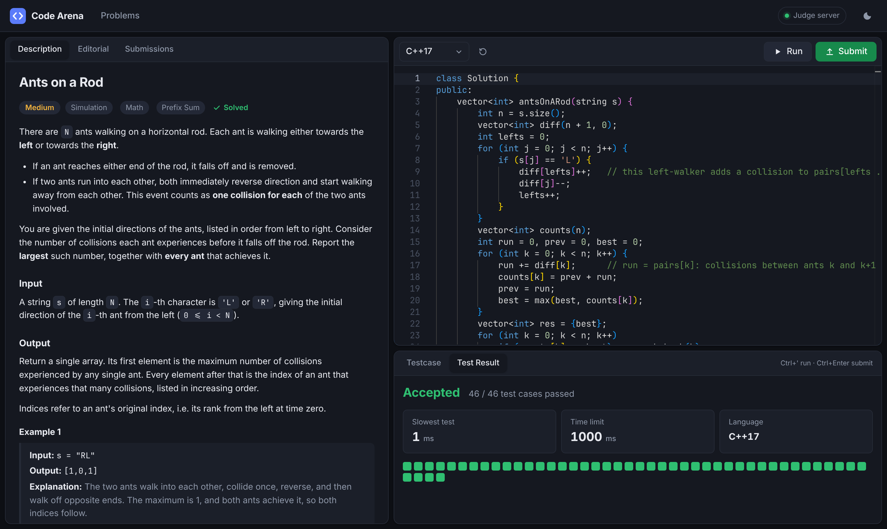

# Code Arena

A small, self-hosted coding practice platform. Read a problem, write a solution in **C++, Java, Python or JavaScript**, **Run** it against the example and custom test cases, then **Submit** it against the full hidden test suite.

It ships with one problem, **Ants on a Rod**, which has 3 example tests, 43 hidden tests (11 of them with N ≈ 100,000, so O(N²) solutions time out), reference solutions in all four languages, an editorial, and a brute-force simulator that cross-checks every expected answer.

**Try it: [ashermatsh.github.io/code-arena](https://ashermatsh.github.io/code-arena/)**, hosted on GitHub Pages. All four languages compile and run right in your browser; no server involved.



## Features

- **Code editor**: Monaco (the VS Code editor) with syntax highlighting. Code is saved per problem and per language in the browser.
- **Run**: runs the cases in the *Testcase* tab. Edit them or add your own; the expected output comes from the reference solution, and inputs are checked against the problem's constraints.
- **Submit**: runs every example and hidden test. You get a verdict (Accepted, Wrong Answer, Time Limit Exceeded, Runtime Error, Compilation Error or Output Limit Exceeded), a pass/fail grid for all tests, and the input, output and expected output of the first failing test. One click adds that input to your test cases.
- **Per-test output**: your `print` / `console.log` / `cout` output is shown under the test case that produced it.
- **Clear errors**: compiler messages and stack traces point at *your* line numbers, without harness noise.
- **Editorial** hidden behind a spoiler, **submission history** with "load code", dark and light themes, resizable panes, mobile layout.
- Keyboard shortcuts: <kbd>Ctrl</kbd>/<kbd>⌘</kbd> + <kbd>'</kbd> to run, <kbd>Ctrl</kbd>/<kbd>⌘</kbd> + <kbd>Enter</kbd> to submit.

## Running it

### Option 1: Node (quickest)

Requires Node.js 20+. The server has no npm dependencies, so there's nothing to install. Each language works if its toolchain is on the `PATH` (`g++`, `javac`/`java`, `python3`); missing ones show as "not installed".

```bash
npm start
```

Open <http://localhost:3000>. The server listens on `127.0.0.1` by default; set `HOST=0.0.0.0` and `PORT=...` to change that.

### Option 2: Docker (all four languages, sandboxed)

```bash
docker compose up --build
```

Open <http://localhost:3000>. The image bundles g++, OpenJDK 17, Python 3 and Node 22. The compose file runs the judge as a non-root user with a read-only filesystem, no Linux capabilities, a process limit, and memory/CPU caps.

### Option 3: GitHub Pages (always on, no server)

The front-end also works without a judge server. In that case it switches to **in-browser mode** and every language runs inside the visitor's browser:

| Language | How it runs | First use | After that |
| --- | --- | --- | --- |
| Python 3 | [Pyodide](https://pyodide.org) (CPython in WebAssembly), in a Web Worker | ~10 MB download | instant |
| JavaScript | a Web Worker | nothing to download | instant |
| C++17 | [Clang/LLD compiled to WebAssembly](https://yowasp.org) (`@yowasp/clang`), program runs as WASI in a Web Worker | ~18 MB compiler download, plus an 11.5 MB precompiled header fetched in the background | ~1–2 s per compile |
| Java 17 | [CheerpJ](https://cheerpj.com) (a Java runtime in WebAssembly) running the real `javac` | Java runtime download, plus a ~15 s first compile while `javac` warms up | ~5–8 s per compile |

Selecting C++ or Java starts loading its toolchain in the background, so it is usually ready by the time you click Run. Everything is cached by the browser after the first visit.

Differences from the judge server:

- **C++** is built with `-fno-exceptions` (WebAssembly WASI has no C++ exception runtime): `try`/`throw` don't compile, and errors such as an out-of-range `.at()` abort with a message instead of throwing. Very deep recursion can hit the browser's stack limit.
- **Java**: CheerpJ runs on the page's main thread and can't be interrupted from outside, so before compiling, the site adds a cheap time check to every loop and method (`shared/java-instrument.js`). Your line numbers are unchanged. The page is unresponsive while Java code runs, for at most the time limit. Stack traces don't include line numbers. CheerpJ is free for personal and non-commercial use and must be loaded from its CDN; see [its licensing](https://cheerpj.com/licensing/) for anything else.
- The hidden tests ship to the browser (it has to grade them itself), so a determined user can read them.

On every push to `main`, `.github/workflows/pages.yml` builds the static site and pushes it to the `gh-pages` branch. GitHub Pages serves that branch (**Settings → Pages → Deploy from a branch → `gh-pages` / root**). To build the static site yourself:

```bash
npm install
```
```bash
npm run build:static
```

That writes the site to `dist/`. `npm install` is optional; it fetches the WebAssembly Clang used to precompile the C++ header, which makes in-browser C++ compiles about 3x faster.

## Tests

```bash
npm test
```

The suite (Node's built-in test runner, about 30 seconds) compiles and runs real programs in every installed language. It checks:

- every reference solution is Accepted on all 46 tests;
- each verdict in each language: wrong answers, infinite loops (TLE), crashes (RE, including C++ segfaults), syntax errors (CE) and runaway output (OLE);
- a correct but O(N²) solution times out on the large hidden tests;
- stdout is attributed to the right test case, and errors point at the user's line;
- every supported parameter/return type round-trips through every language's driver;
- every stored test satisfies the constraints and matches the reference solution;
- the reference solution agrees with an exact **physical simulation** of the ants (`problems/ants-on-a-rod/tools/verify.py`): every direction string up to length 10, plus random longer ones, each on several random rod layouts;
- the Java instrumentation used in the browser keeps tricky valid Java (records, pattern matching, `while (true)` returns, lambdas, text blocks…) compiling with identical results, and stops runaway loops and recursion;
- the HTTP API (including that hidden tests and files outside `public/` aren't served) and the static build.

CI (`.github/workflows/ci.yml`) runs the same suite with all four toolchains installed.

## How judging works

1. The server generates a small **driver** for the chosen language from the problem's function signature, writes it next to your code, and compiles it (`g++ -O2 -std=c++17`, `javac`, or a syntax check for Python and JavaScript).
2. One process runs **every test in sequence**, which keeps the JVM and interpreter start-up cost to a single run. Before each test the driver prints a random marker; the server uses these markers to time each test, attribute stdout, and kill the process as soon as one test goes over its limit.
3. Results (return value as JSON, plus the time spent inside your function) are compared with the expected answers by `shared/judging.js`. The in-browser mode uses the same file, so both modes grade identically.

Limits: per-test time is the problem's `timeLimitMs` (1000 ms for Ants on a Rod) times a language factor (server: C++ ×1, Java ×2, JavaScript ×2, Python ×3; browser: C++ ×2, Java ×3, JavaScript ×2, Python ×6). Each run is also capped at 1 GB of address space for C++/Python (512 MB heap for Java/JavaScript), a CPU-time ceiling and a 2 MB stdout cap. Up to `MAX_CONCURRENCY` submissions (default: number of CPUs, max 4) run at once; the rest queue.

> **Security note:** submitted code runs as a normal process with resource limits, not in a full sandbox. That's fine on your own machine or inside the provided Docker setup. Before exposing the judge to untrusted users on the public internet, put it behind authentication and run it in a stronger sandbox (gVisor, Firecracker, or nsjail). The GitHub Pages mode has no such concern: code only ever runs in the visitor's own browser.

## Adding a problem

Create a folder under `problems/<slug>/` (lowercase letters, digits and dashes):

```
problems/<slug>/
  problem.json        title, difficulty, tags, function signature, time limit
  statement.md        the statement; put {{examples}} where the examples should appear
  editorial.md        optional write-up (shown behind a spoiler)
  reference.mjs       export function solve(...args) and validate(...args)
  tests/samples.json  example tests shown to the user
  tests/hidden.json   hidden tests used on submit
```

`problem.json`:

```json
{
  "title": "Ants on a Rod",
  "difficulty": "Medium",
  "tags": ["Simulation", "Math", "Prefix Sum"],
  "function": {
    "name": "antsOnARod",
    "params": [{ "name": "s", "type": "string" }],
    "returns": "int[]"
  },
  "timeLimitMs": 1000,
  "compare": "exact"
}
```

Supported types for parameters and return values: `int`, `long`, `double`, `boolean`, `string`, `int[]`, `long[]`, `double[]`, `boolean[]`, `string[]`, `int[][]`. Starter code and drivers for all four languages are generated from the signature, so a new problem needs no per-language code. Use `"compare": "float"` to accept doubles within 1e-6.

Each test is `{ "args": [...], "expected": ..., "explanation"?: "..." }`, with one test per array element. The `explanation` field is shown for examples only. `reference.mjs` must be plain browser-compatible JavaScript: the server uses it to produce expected answers for custom test cases, and so does the browser in in-browser mode. Restart the server after adding a problem, then run `npm test`, which validates every problem's tests against its reference solution.

For Ants on a Rod, `npm run gen:tests` regenerates the tests and `npm run verify` re-runs the brute-force cross-check.

## Project layout

```
server/          judge server (Node built-ins only)
  index.js         HTTP server: static files, problem data, /api/run, /api/submit
  service.js       run/submit: validation, expected answers, summaries
  judge.js         compile, execute with limits, per-test watchdog, stdout capture
  drivers.js       starter code + per-language drivers generated from signatures
  languages.js     compile/run commands, toolchain detection
  problems.js      loads problems/ from disk
shared/            used by both the server and the browser
  judging.js       grading, result formatting, test input encoding
  toolchains.js    in-browser compiler versions and flags
  java-instrument.js  time checks for Java running in the browser
public/          front-end (plain ES modules, no build step)
  js/app.js        problem list and workspace UI
  js/backend.js    server backend / in-browser backend
  js/runners/      in-browser runners: JavaScript, Python (Pyodide),
                   C++ (cpp-worker compiles, wasi-worker runs), Java (java-frame)
problems/        problem data, reference solutions, test generators
scripts/         static build for GitHub Pages
test/            test suite
```
